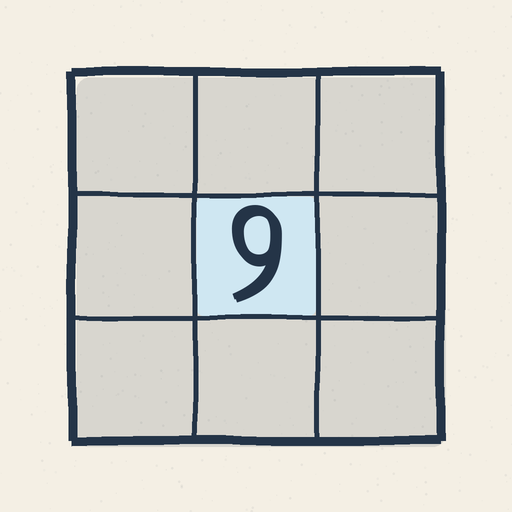
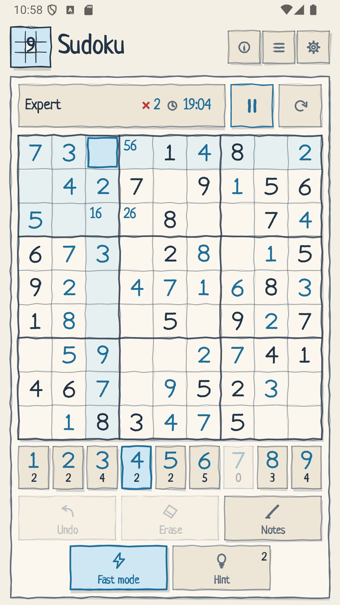

<p align="center">
  
</p>

<h1 align="center">Sudoku for Android</h1>

<p align="center">
  <a href="https://play.google.com/store/apps/details?id=me.zakharenka.sudoku">
    
  </a>
  <a href="https://f-droid.org/packages/me.zakharenka.sudoku/">
    
  </a>
</p>

<p align="center">
  <a href="fastlane/metadata/android/en-US/images/phoneScreenshots/01-game.jpg">
    
  </a>
</p>

A classic 9×9 Sudoku for Android built with Kotlin and Jetpack Compose. The
interface is drawn by hand in a sketch style: paper texture, wobbly lines, a
handwritten font and a square grid with no rounded corners. Nine languages are
supported: English, Russian, Spanish, Portuguese (Brazil), French, German,
Italian, Ukrainian and Belarusian. The default language comes from the system
and is changed through the native Android app-language settings.

The app is free software under the GNU General Public License v3.0 or later.
The source code is hosted on GitHub, and the project ships the metadata needed
for distribution on Google Play and F-Droid.

## Features

- four difficulty levels: Easy, Medium, Hard and Expert;
- puzzle generation with a single solution;
- cell digits are drawn as hand-written pencil strokes with a writing and
  erasing animation;
- hardware keyboard support: digits and numpad enter values, `0`, Backspace and
  Delete erase, arrow keys move the selected cell;
- cell notes, hints (three per game), undo and clear cell;
- fast mode: choose a digit on the number pad, then tap cells to place it;
  in notes mode the same tap toggles that note;
- timer, a mistake counter (can be disabled per game), and pause with
  auto-pause when leaving the app;
- single-row top bar: difficulty, mistakes (when enabled) and timer in one
  block, with unlabelled pause and new-game buttons on the right;
- adaptive layout: on tablets in landscape the board is on the left and the
  controls on the right; in portrait it is a comfortable single column;
- new game through a dialog: confirmation, difficulty selection, a "show
  mistakes" option, and Start and Cancel buttons; the dialog opens from the
  new-game button or by tapping the current difficulty;
- records per difficulty and result: best time and number of solved games
  with and without mistakes, derived from the game history;
- game history grouped by day, with a mini puzzle preview, solved or
  in-progress status, start and finish dates, elapsed time, mistakes and used
  hints; tapping a row loads that game on pause;
- backup to a file and restore through the system file picker;
- nine languages: English, Russian, Spanish, Portuguese (Brazil), French,
  German, Italian, Ukrainian and Belarusian; the default language comes from
  the system and is changed through the native Android "App language" screen;
- light and dark themes, plus a "follow system" mode;
- settings: theme selection, board line style, same-digit highlighting, a
  shortcut to the system language picker, backup import/export and a link to
  the developer website;
- straight grid lines on the 9×9 board by default, with an option to switch
  back to hand-drawn wobbly lines;
- the current game is saved to a local file when the app goes to the
  background: the timer stops and the game is restored on pause the next time
  it starts;
- win screen with the time and a new-record message;
- hand-drawn app icon: light and dark variants, plus a monochrome icon with a
  digit for Android themed icons.

## Stack

- Kotlin 2.3.21, Jetpack Compose (Material 3), Compose BOM 2026.09.00;
- AGP 9.4.1, Gradle 9.6, JDK 17+;
- minSdk 26, targetSdk 37, compileSdk 37;
- SharedPreferences for settings and one atomic local file for the current
  game and history;
- `android:localeConfig` and native Android 13+ per-app language settings.

The app does not use the network, does not include analytics and requests no
permissions.

## Version

The version is defined in one place — `gradle.properties`:

```properties
app.version=MAJOR.MINOR.PATCH
```

`app/build.gradle.kts` uses this value as `versionName` and derives
`versionCode` with this scheme:

```text
major * 1_000_000 + minor * 1_000 + patch
```

The current value is whatever is set in `gradle.properties`. Use
`python3 scripts/set-version.py X.Y.Z` to update it; the helper also keeps
`fdroid/version.json` in sync. Versions follow semantic versioning
`MAJOR.MINOR.PATCH`; release versions are marked with annotated git tags.

## Building

```bash
./gradlew :app:assembleDebug
```

The APK is written to `app/build/outputs/apk/debug/app-debug.apk`.

Installing on a connected device or emulator:

```bash
adb install -r app/build/outputs/apk/debug/app-debug.apk
```

Release build (R8, unsigned):

```bash
./gradlew :app:assembleRelease
```

The APK is written to `app/build/outputs/apk/release/app-release-unsigned.apk`.

GitHub and Gitea run `.github/workflows/ci.yaml` on `ubuntu-latest`. A push to
`master` and a pull request run the unit tests, `lintDebug` and
`assembleDebug`. A tag `X.Y.Z` must match `app.version` and also builds the
unsigned release APK and AAB. The artifacts are attached to the workflow run.

## Documentation

| Document | Contents |
| --- | --- |
| [`docs/architecture.md`](docs/architecture.md) | modules, boundaries, data flow and key files |
| [`docs/data-storage.md`](docs/data-storage.md) | settings, saved game format, persistence and backup |
| [`docs/game-rules.md`](docs/game-rules.md) | rules, hints, records and history |
| [`docs/ui-guidelines.md`](docs/ui-guidelines.md) | dialogs, top bar, keyboard, tablets, sketch style and icon |
| [`docs/release-process.md`](docs/release-process.md) | versioning, release checklist, Google Play and F-Droid |
| [`docs/screenshots.md`](docs/screenshots.md) | store screenshot sizes, capture steps and fixture data |
| [`docs/languages.md`](docs/languages.md) | supported languages and the plan for new ones |
| [`docs/releases/`](docs/releases/) | release notes by version |

## Publishing

- Google Play and F-Droid:
  [`docs/release-process.md`](docs/release-process.md).

## Tests and checks

```bash
./gradlew :app:testDebugUnitTest
```

Covered: the puzzle generator, solution counting, game actions (input, notes,
clear, undo, hint limit, victory), hidden and visible error modes, game
record restore and record rules.

Full check before committing:

```bash
./gradlew :app:testDebugUnitTest :app:lintDebug :app:assembleRelease
```

Synthetic history for UI, import and performance checks:

```bash
python3 scripts/generate-history.py --count 1000
```

The script writes `build/sudoku-history.json` in the app's backup format. Use
`--seed`, `--start-date`, `--current-index` and `--output` to change the data.

## Structure

```text
app/src/main/java/me/zakharenka/sudoku/
├── MainActivity.kt          # entry point, edge-to-edge, save on onStop
├── SudokuViewModel.kt       # game state, timer, generation, persistence, import/export
├── data/
│   ├── SettingsStore.kt     # global settings in SharedPreferences
│   ├── SudokuDataStore.kt   # atomic file storage for the current game and history
│   ├── SudokuDataCodec.kt   # shared parser/validator
│   └── ThemeMode.kt         # system / light / dark theme
├── game/
│   ├── Difficulty.kt        # difficulty levels and clue count
│   ├── GameRecord.kt        # one saved game and its validation
│   ├── SudokuData.kt        # history and records derived from solved games
│   ├── SudokuGenerator.kt   # generator and solver
│   ├── SudokuSession.kt     # game rules with no Android dependencies
│   └── Formatters.kt        # time and date formatting
└── ui/
    ├── SudokuScreen.kt      # screen, header, settings and dialogs
    ├── SudokuBoard.kt       # 9×9 board with a hand-drawn grid
    ├── SudokuControls.kt    # top bar, digits, actions, overlays
    ├── sketch/
    │   ├── Sketch.kt        # hand-drawn lines, panels, buttons, texture
    │   ├── SketchIcons.kt   # hand-drawn icons
    │   └── HandwrittenDigits.kt  # animated pencil digits
    └── theme/
        ├── Theme.kt         # light and dark palettes
        └── Type.kt          # handwritten font

app/src/test/java/me/zakharenka/sudoku/game/   # JUnit tests for game logic

app/src/main/res/
├── values/                  # English (default)
├── values-ru/               # Russian
├── values-es/               # Spanish
├── values-pt-rBR/           # Portuguese (Brazil)
├── values-fr/               # French
├── values-de/               # German
├── values-it/               # Italian
├── values-uk/               # Ukrainian
├── values-be/               # Belarusian
├── xml/locales_config.xml   # languages for the native Android language picker
├── drawable/                # hand-drawn app icons
└── font/neucha.ttf          # Neucha handwritten font

fastlane/metadata/android/   # store texts and graphics for Google Play and F-Droid
metadata/                    # F-Droid build recipe
scripts/                     # release, store-package and test-data helpers
docs/                        # architecture, rules, UI, publishing and release notes
```

Each `values-*` folder contains `strings.xml` and `plurals.xml`.

The game logic in `game/` has no Android dependencies and is covered by plain
JUnit tests. The UI does not hold game rules: it only renders `GameUiState` and
sends actions to `SudokuViewModel`.

## How a game works

`SudokuGenerator` creates a complete solution and removes digits while checking
that the solution stays unique. `SudokuSession` stores cells, notes, mistakes
and move history and decides when the game is won. `SudokuViewModel` drives
background generation, the timer, pause, saving, restoring, history and data
import/export.

See [`docs/game-rules.md`](docs/game-rules.md) and
[`docs/data-storage.md`](docs/data-storage.md) for the full behavior and storage
rules.

## Localization

English is the default language. The app currently supports `en`, `ru`, `es`,
`pt-BR`, `fr`, `de`, `it`, `uk` and `be`. All user-facing strings live in
`values*/strings.xml`; plural forms live in `plurals.xml`. The app settings
have no language picker of their own: the "Change language" button opens the
system `android.settings.APP_LOCALE_SETTINGS` screen.

See [`docs/languages.md`](docs/languages.md) for the translation plan and the
checklist for adding a language.

## Font and icon

The interface uses the **Neucha** font (SIL Open Font License 1.1). The font
file is `app/src/main/res/font/neucha.ttf` and the license is in
`app/src/main/assets/licenses/Neucha-OFL.txt`.

The app icon is an adaptive icon with hand-drawn light and dark variants and a
monochrome layer showing the digit 9. See
[`docs/ui-guidelines.md`](docs/ui-guidelines.md) for the icon and style rules.

## License

Copyright (C) 2026 Aliaksandr Zakharenka.

This program is free software: you can redistribute it and/or modify it under
the terms of the GNU General Public License as published by the Free Software
Foundation, either version 3 of the License, or (at your option) any later
version.

This program is distributed in the hope that it will be useful, but WITHOUT ANY
WARRANTY; without even the implied warranty of MERCHANTABILITY or FITNESS FOR A
PARTICULAR PURPOSE. See the GNU General Public License for more details.

The full text is in [`LICENSE`](LICENSE).

The Neucha font is licensed separately under the SIL Open Font License 1.1; see
`app/src/main/assets/licenses/Neucha-OFL.txt`.
